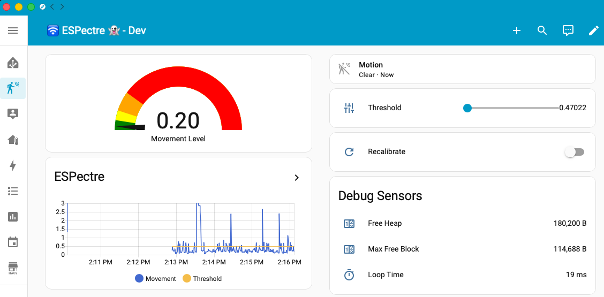

# ESPectre ESPHome frontend

The ESPHome frontend gives Home Assistant users motion detection as ESPHome entities. Sensing comes from the [`espectre` component built into ESPHome](https://esphome.io/components/espectre/). This repository adds the `espectre_direct` add-on for the browser tools and the CLI, the example configurations, and the official images. For installation, placement, and the first detection check, start with the [setup guide](../../../../docs/SETUP.md).

The examples and official images need ESPHome 2026.11 or later. The external component that earlier releases loaded from this repository is gone; see [moving from the external component](#moving-from-the-external-component).

## Getting started

After flashing, configure Wi-Fi with one of these provisioning paths:

| Method | How |
|--------|-----|
| USB | Use Improv Serial with `./espectre provision --ssid MyNetwork` or any Improv Serial-compatible web flasher, such as the [ESPectre web flasher](https://espectre.dev/tools/flash/) |
| Captive portal | Connect to the `ESPectre Fallback` network and finish setup in the browser |

The examples keep the SSID, password, and BSSID out of YAML. After provisioning, Improv Serial returns a link to Device settings.

Once Wi-Fi is set up, Home Assistant discovers the device through ESPHome.

While sensing runs, the built-in component stops ESPHome's periodic roaming scans, because each one takes the radio off-channel for seconds and interrupts sensing. Losing the access point still triggers a normal reconnect.

Official images add the last three MAC bytes to the ESPHome hostname, for example `espectre-a1b2c3.local`. This lets one image serve multiple devices on the same network. The Home Assistant device and entity IDs use the same suffix.

## Integration surface

`espectre:` runs sensing. Each entity is declared under its ESPHome platform; the examples take theirs from [espectre-entities.yaml](examples/espectre-entities.yaml), listed in [entities of the examples](#entities-of-the-examples).

The `espectre_direct` add-on runs ESPectre's Direct HTTP API next to the ESPHome API. Direct offers the same sensing controls plus live telemetry and raw CSI collection; find the device with `./espectre devices --frontend esphome`. See the [API reference](../../../../docs/API.md) and [discovery reference](../../../../docs/DISCOVERY.md).

The examples include the add-on. To keep only the ESPHome API and entities, leave it out; see [the Direct API add-on](#the-direct-api-add-on).

Changes made through Direct show up in Home Assistant right away. Wi-Fi credentials, the device name, OTA, and API encryption stay under ESPHome's control.

## Configuration surface

Sensing options go under `espectre:`. The [ESPHome documentation](https://esphome.io/components/espectre/) lists every option; [shared sensing options](../../../../docs/SDK.md#shared-sensing-options) gives their defaults and ranges. See [tuning essentials](../../../../docs/TROUBLESHOOTING.md#tuning-essentials) for what to adjust.

Set the capture profile in YAML and rebuild to change it:

```yaml
espectre:
  csi_capture_profile: lltf # auto (default), lltf, or ht_vht
```

The profile cannot be changed from Home Assistant or Direct. The `wifi_raw` source needs `auto` or `lltf`. See [capture profiles](../../../../docs/CSI.md#capture-profiles) for what each value selects.

### Diagnostic telemetry

In the examples, the diagnostic sensors update only when you press `Refresh Diagnostics`. Direct also reports performance, memory, and detector timing; see [API diagnostics](../../../../docs/API.md#diagnostics). To read the rates, see [check the sensing input](../../../../docs/TROUBLESHOOTING.md#check-the-sensing-input).

### Detection profile selection

```yaml
wifi:
  band_mode: AUTO  # ESP32-C5 only; optional because AUTO is the default

espectre:
  detection_algorithm: lightweight  # or high_accuracy
```

On ESP32-C5, `wifi.band_mode` accepts `2.4GHz`, `5GHz`, or `AUTO` (default). Other chips use 2.4 GHz.

`detection_algorithm` is only the starting profile. The `Detection Profile` select changes it live and remembers the choice. Switching to Lightweight starts a calibration, shown by `Calibration Active`. See [detection profile](../../../../docs/TROUBLESHOOTING.md#detection-profile) to choose.

At boot, the threshold starts from the selected profile's SDK default: High Accuracy uses `0.5`, and Lightweight adapts its fitted base threshold through startup calibration. Manual threshold changes last until recalibration or reboot.

## Entity customization

### Entities of the examples

| Platform and key | Name in the examples | Description |
|------------------|----------------------|-------------|
| `sensor`, `movement` | `Movement Score` | Current movement score (0.0–1.0), published every `evaluation_interval` |
| `binary_sensor`, `motion` | `Motion Detected` | Motion state, published when it changes |
| `binary_sensor`, `calibrating` | `Calibration Active` | Whether calibration is running |
| `number`, `threshold` | `Threshold` | Runtime probability threshold (0.0–1.0) |
| `number`, `motion_on_hits` | `Motion On Hits` | Runtime motion-on debounce count (1–20) |
| `number`, `motion_off_hits` | `Motion Off Hits` | Runtime motion-off debounce count (1–20) |
| `select`, `detection_algorithm` | `Detection Profile` | Runtime `lightweight` / `high_accuracy` selection |
| `select`, `traffic_generator_mode` | `CSI Traffic Source` | Runtime `ping` / `dns` (UDP) / `dns_tcp` / `wifi_raw` / `external` selection |
| `select`, `csi_sample_spacing` | `CSI Packet Spacing` | Runtime `half_slot` / `distinct` packet spacing |
| `switch`, `sensing` | `Sensing Enabled` | Enables or pauses sensing |
| `button` | `Recalibrate` | Starts runtime recalibration |
| `button` (template) | `Refresh Diagnostics` | Publishes the latest diagnostic sample on demand |
| `sensor`, `diagnostics`, `generator_rate` | `Generator Rate` | Successful internal generator sends; zero in external mode |
| `sensor`, `diagnostics`, `traffic_tx_rate` | `Traffic TX Rate` | Station network packets accepted by the driver |
| `sensor`, `diagnostics`, `traffic_rx_rate` | `Traffic RX Rate` | Station network packets delivered by the driver |
| `sensor`, `diagnostics`, `csi_callback_rate` | `CSI Callback Rate` | Raw CSI callback rate |
| `sensor`, `diagnostics`, `csi_accepted_rate` | `CSI Accepted Rate` | Raw identity-accepted capture rate before temporal admission |
| `sensor`, `diagnostics`, `csi_missing_slot_rate` | `CSI Missing Slot Rate` | Missing detector slots per second |
| `sensor`, `diagnostics`, `csi_excess_rate` | `CSI Excess Rate` | Non-selected same-slot candidates per second, including candidates replaced by one nearer the slot center |
| `sensor`, `diagnostics`, `csi_occupancy` | `CSI Temporal Occupancy` | Valid-slot occupancy of the active detector window |
| `sensor` (`wifi_signal`) | `WiFi RSSI` | Current associated Wi-Fi RSSI |

The names match the entities of earlier ESPectre images, so dashboards and automations keep working after an update.

All entities support standard ESPHome options such as `name`, `internal`, `icon`, and `disabled_by_default`. The movement sensor also supports ESPHome [sensor filters](https://esphome.io/components/sensor/#sensor-filters). In your own YAML, declare only the entities you want:

```yaml
sensor:
  - platform: espectre
    movement:
      name: "Living Room Movement"
      internal: true
      icon: "mdi:sine-wave"
      filters:
        - multiply: 100
        - clamp:
            min_value: 0
            max_value: 100
        - round: 1

binary_sensor:
  - platform: espectre
    motion:
      name: "Living Room Motion"
      icon: "mdi:motion-sensor"

number:
  - platform: espectre
    threshold:
      name: "Living Room Threshold"
```

Use `internal: true` on the movement sensor when you want to keep the binary motion entity for automations without publishing the raw score to Home Assistant.

A configuration that extends an example can follow one of its entities with the ESPHome `copy` platform, as [espectre-s3-led.yaml](examples/espectre-s3-led.yaml) does for the motion state.

## Home Assistant integration

Once the device is flashed and connected to Wi-Fi:

1. Home Assistant discovers it through ESPHome
2. Go to **Settings** -> **Devices & Services** -> **ESPHome**
3. Configure the discovered device
4. The entities of the configuration are added automatically

How entities update:

- Writable entities always show the value the device is using, even after a rejected change.
- Movement Score updates at every evaluation (250 ms by default). Motion Detected updates only when the state changes.
- Threshold also updates after calibration and when Lightweight lowers it automatically.

Movement Score produces a lot of history. To keep the recorder small, exclude `sensor.*_movement_score` rather than slowing the evaluation interval.

To manage configuration and OTA updates, adopt the device in ESPHome Device Builder. The adopted configuration builds from the GitHub `main` branch and reports version `0.0.0-main`. To stay on a release, use a prebuilt image instead: download `espectre-esphome-<channel-or-version>-<chip>-ota.bin` from GitHub Releases and upload it:

```bash
./espectre esphome flash --chip c6 --device espectre-<mac-suffix>.local --firmware espectre-esphome-3.2.0-esp32c6-ota.bin
```

An older installation without the MAC suffix is still at `espectre.local` for this upload. Afterwards, use `espectre-<mac-suffix>.local`.

### Dashboard examples

[home-assistant-dashboard.yaml](examples/home-assistant-dashboard.yaml) provides motion, movement score, history, controls, and diagnostics.



*Home Assistant dashboard with motion state, movement score, movement-versus-threshold history, detection profile, threshold, calibration, and diagnostics.*

To import a dashboard:

1. Go to **Settings** -> **Dashboards** -> **Add Dashboard**
2. Open the dashboard and choose **Edit**
3. Open the raw configuration editor
4. Replace the default content with the YAML from the example file
5. Save the dashboard

Official images add the MAC suffix to entity IDs, so update the IDs in the dashboard to match your device (and the `espectre` prefix, if you renamed it). Check the exact IDs in Home Assistant: a name clash can add a suffix such as `_2`.

## Traffic configuration

Traffic settings go under `espectre:`. See [traffic sources](../../../../docs/CSI.md#traffic-sources) for how they work.

### Internal traffic generator

```yaml
espectre:
  csi_target_pps: 100
  traffic_generator_mode: ping
  # traffic_generator_target_ip: 192.168.1.10 # Default: the gateway
```

The `CSI Traffic Source` select changes the source at runtime, including `external`, and the device remembers it. With `wifi_raw`, `traffic_generator_target_mac` sends to another sensor instead of the access point; it is a YAML option only. ESP32-C6 does not offer `wifi_raw`; see [compatibility limits](../../../../docs/CSI.md#compatibility-limits).

### External traffic mode

On Home Assistant OS, the ESPectre Traffic Generator add-on can send the traffic and switch devices to external mode from its panel. See the [web guide](https://espectre.dev/guides/home-assistant/#ha-traffic-generator) and the [add-on documentation](../../../../tools/ha_traffic_generator_addon/DOCS.md).

To use external traffic in YAML:

```yaml
espectre:
  csi_target_pps: 100
  traffic_generator_mode: external
  csi_traffic_multicast_group: "239.255.0.1"
```

Raw collection needs the Direct API add-on; see the [`collect` command](../../../../docs/CLI.md#collect). Collection switches the device to external mode, and it stays there afterwards.

### Sample spacing

On a busy channel, packets can arrive in back-to-back pairs and leave the slot before each pair empty. `distinct` lets the earlier packet fill it:

```yaml
espectre:
  csi_sample_spacing: distinct # Default: half_slot
```

The YAML value is where the device starts. The `CSI Packet Spacing` select and Direct change it at runtime, and the device remembers the last choice.

See [low occupancy](../../../../docs/TROUBLESHOOTING.md#low-occupancy) for when to use it.

## Build and consumption

The `release`, `preview`, and `develop` channels publish a full-flash image and an OTA image for each chip. They are built from the examples: the built-in component, the Direct API add-on, and both detection profiles, with Lightweight as the starting one.

The example YAML and normal Device Builder builds are not signed, and a device with an official image rejects them over OTA. Install the first one over USB (see [official images and personal builds](../../../../docs/SETUP.md#official-images-and-personal-builds)), or enable ESPHome's `signed_ota_verification` with your own key.

### The Direct API add-on

The built-in component has no Direct API. The `espectre_direct` add-on in this repository adds it, so the [browser tools](https://espectre.dev/tools/) and the CLI commands that talk to the device work:

```yaml
external_components:
  - source:
      type: git
      url: https://github.com/francescopace/espectre
      path: src/cpp/frontend/esphome/components
    components: [espectre_direct]

espectre:

espectre_direct:
```

Omit `ref` to follow the default branch, or set a tag or commit to pin the add-on. An empty `ref: ""` is invalid.

| Option | Default | Meaning |
|--------|---------|---------|
| `port` | `62587` | Port of the Direct API |
| `raw_csi` | `true` | Offer CSI collection |
| `sdk` | none | SDK to build with, in place of the release that ESPHome installs: `version` for a published release, or `path` for a local SDK directory |

The add-on needs ESPectre SDK 3.2.0 or later, which ESPHome installs since 2026.11.

The add-on serves the device and sensing resources, live events, CSI collection, and discovery. It never changes sensing itself: it hands each change to the built-in component, which applies it, updates its entity, and saves it. The device accepts a change only when the entity type behind it is in the YAML: the threshold and motion hits need the `number` platform, the detection profile, traffic source, and packet spacing need the `select` platform, and the sensing switch needs the `switch` platform.

The device name, the access point pin, the `wifi_raw` destination, the Wi-Fi settings, and MQTT are not available through the add-on. Manage them in the YAML.

`esphome.project.version` sets the firmware version that the Direct API reports. The SDK version is separate; see [versioning](../../../../docs/SDK.md#versioning).

### Moving from the external component

Earlier ESPectre releases loaded an `espectre` component from this repository through `external_components`. ESPectre 3.3 removes it. Update ESPHome to 2026.11 or later, remove `espectre` from `external_components`, add `espectre_direct` if you use the browser tools or the CLI, and declare the entities as platforms:

| External component, under `espectre:` | Built-in component |
|----------------------------------------|--------------------|
| `movement_sensor` | `sensor` platform, `movement` |
| `motion_sensor`, `calibration_active_sensor` | `binary_sensor` platform, `motion` and `calibrating` |
| `threshold_number`, `motion_on_hits_number`, `motion_off_hits_number` | `number` platform, `threshold`, `motion_on_hits`, and `motion_off_hits` |
| `detector_select`, `traffic_generator_mode_select`, `csi_sample_spacing_select` | `select` platform, `detection_algorithm`, `traffic_generator_mode`, and `csi_sample_spacing` |
| `sensing_switch` | `switch` platform, `sensing` |
| `recalibrate_button` | `button` platform |
| The rate and occupancy sensors | `sensor` platform, `diagnostics` |
| `wifi_rssi_sensor` | ESPHome's `wifi_signal` sensor |
| `diagnostics_button` | A template button that updates the `diagnostics` sensors |
| `direct_api` | The `espectre_direct` add-on |

Some sensing options change name: `segmentation_window_size_ms` becomes `window_size`, `evaluation_interval_ms` becomes `evaluation_interval`, and the filter options become the `lowpass_filter` and `hampel_filter` blocks. The built-in diagnostics have no admitted, filtered, stale, or out-of-order rate, and no Wi-Fi channel. [espectre-entities.yaml](examples/espectre-entities.yaml) shows every entity with its earlier name.

A configuration adopted from an earlier example follows `main`, so its next build uses the built-in component and needs ESPHome 2026.11 or later.

### Example configurations

Each maintained chip has one example. By default it includes `espectre-source-github.yaml`, which loads the add-on from GitHub. Repository development selects `espectre-source-local.yaml` instead, which loads the add-on from the local checkout and builds the SDK of that checkout in place of the release that ESPHome installs.

### Repository CLI

See the [CLI reference](../../../../docs/CLI.md) for all options.

```bash
./espectre esphome build --chip c6 --clean
./espectre esphome flash --chip c6
./espectre esphome config --chip c6
./espectre esphome monitor --chip c6 --device /dev/cu.usbmodemXXXX
```

On Windows, use `.\espectre.cmd esphome ...` from the repository root and pass a COM port such as `COM5` to `--device` when serial access is needed.

The CLI builds the chip's example YAML with the add-on and the SDK from your local checkout, and sets the version from `git describe`. Use `flash` to upload without building and `monitor` for logs.

## Hardware and packaging notes

### Build toolchain

The ESPHome examples use the native ESP-IDF backend from the ESPHome version pinned in [`requirements.txt`](../../../../requirements.txt). The built-in component installs the ESPectre SDK from the ESP Component Registry. No toolchain override or separate library is needed.

### Automatic SDK configuration

The built-in component sets the CSI and Wi-Fi options it needs and sends runtime logs to the ESPHome logger. Put board-specific overrides under `esp32.framework.sdkconfig_options`.

The examples use Improv Serial instead of BLE provisioning, which saves flash and memory and avoids radio contention. Keep it that way unless you need BLE.

### Flash size and partitions

The firmware fits in 4 MB of flash with OTA and uses the default partition table. You can override it with `esp32.partitions` if needed.

## ESPHome-specific troubleshooting

For sensing and connection problems, see the [troubleshooting guide](https://espectre.dev/guides/troubleshooting/) and, for the device log and configuration options, the [troubleshooting reference](../../../../docs/TROUBLESHOOTING.md). If the board does not enter download mode, see [web flash](../../../../docs/SETUP.md#web-flash-no-coding-required).

### Bluetooth proxy and CSI occupancy

Bluetooth and Wi-Fi share the radio, so a Bluetooth proxy can lower CSI occupancy. If it does, compare with Bluetooth disabled first. For a proxy that only forwards advertisements, these experimental settings had the smallest impact in our tests. Merge them into your existing configuration:

```yaml
esp32:
  cpu_frequency: 240MHz
  framework:
    type: esp-idf
    sdkconfig_options:
      CONFIG_ESP_COEX_SW_COEXIST_ENABLE: n

bluetooth_proxy:
  active: false

esp32_ble_tracker:
  software_coexistence: false
  scan_parameters:
    interval: 100ms
    window: 5ms
    duration: 5min
    active: false
    continuous: true

espectre:
  traffic_generator_mode: wifi_raw
```

- The `sdkconfig_options` line is required. With ESPHome 2026.8.2 and ESP-IDF 5.5.5, `software_coexistence: false` alone left ESP-IDF coexistence enabled, even after a clean build.
- Run **Clean Build Files**, rebuild, and install. The generated SDK configuration must contain `# CONFIG_ESP_COEX_SW_COEXIST_ENABLE is not set`.
- `bluetooth_proxy.active: false` turns off active GATT connections but still forwards advertisements. `scan_parameters.active: false` selects passive scanning.
- Short scan windows receive fewer advertisements. Check that the BLE devices you rely on still report.
- Active GATT connections were not tested with these settings. For `wifi_raw` limits, see [compatibility limits](../../../../docs/CSI.md#compatibility-limits).

The tests for [issue #165](https://github.com/francescopace/espectre/issues/165) used one ESP32-S3 at 240 MHz, a fixed position and access point, and `wifi_raw` at 100 pps. Each run lasted 60–120 seconds, and the first 15 seconds were excluded:

| Scan window / interval | Scan type | Tracker coexistence | ESP-IDF coexistence | Mean CSI occupancy per run |
|------------------------|-----------|---------------------|---------------------|----------------------------|
| BLE disabled | — | — | — | 94.1%, 88.8%, 94.0% |
| 320 / 320 ms | Active | On | On | 52.3% |
| 30 / 320 ms | Passive | On | On | 53.2% |
| 10 / 100 ms | Passive | On | On | 53.3%, 54.4% |
| 5 / 100 ms | Passive | On | On | 53.6%, 51.9% |
| 10 / 100 ms | Active | On | On | 54.0% |
| 10 / 100 ms | Passive | Off | On | 56.7% |
| 5 / 100 ms | Passive | Off | On | 56.5% |
| 30 / 320 ms | Passive | Off | Off | 84.4% |
| 10 / 100 ms | Passive | Off | Off | 88.5%, 87.6% |
| 5 / 100 ms | Passive | Off | Off | 93.4%, 91.1%, 92.6% |

In the final two-minute run with the 5 ms window, the proxy still received 433 advertisements from 26 devices. The 10 ms window received about twice as many, with lower occupancy. These are short tests on one board and network, not a general compatibility result.

### View logs

The runtime logs an `IDLE | csi:` or `MOTION | csi:` status line every second. It appears on USB serial and in `esphome logs` when the `espectre.runtime` tag allows INFO messages.

```bash
esphome logs <your-config>.yaml
esphome logs <your-config>.yaml --device espectre.local
./espectre monitor --port /dev/cu.usbmodem*
```

## Implementation map

Sensing and its entities are in ESPHome's own [`espectre` component](https://github.com/esphome/esphome/tree/dev/esphome/components/espectre). This directory holds what the repository adds. See [frontend layer](../../../../docs/ARCHITECTURE.md#srccppfrontend) for source groups.

- [`components/espectre_direct/`](components/espectre_direct/): the Direct API add-on. [`__init__.py`](components/espectre_direct/__init__.py) has the YAML schema and the SDK selection; [`espectre_direct.cpp`](components/espectre_direct/espectre_direct.cpp) serves the API over the SDK and hands sensing changes to the built-in component
- [`espectre_emulator_csi_replay/`](espectre_emulator_csi_replay/): ESP-IDF component that links the [emulator CSI replay](../../../../tools/README.md) into the published images
- [`examples/`](examples/): configurations for ESP32, ESP32-S2, ESP32-S3, ESP32-C3, ESP32-C5, and ESP32-C6, their shared entities and source packages, board variants, and the Home Assistant dashboard
